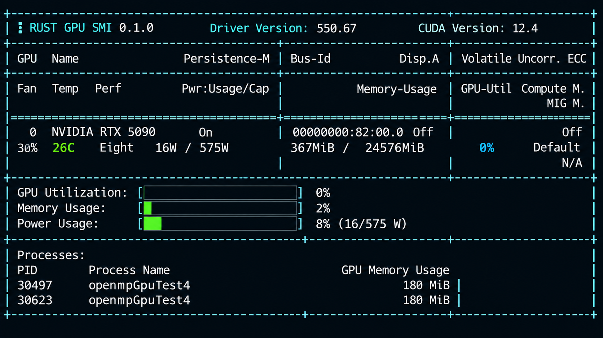

# Rust GPU SMI

**A lightweight GPU monitoring tool for Linux, written in Rust.**

Rust GPU SMI is a terminal-based application designed to monitor GPU information and system metrics in real time.

The project aims to provide a lightweight, efficient, and easy-to-use monitoring experience for Linux environments.

## Features

- Real-time GPU monitoring.
- GPU utilization monitoring.
- GPU memory usage.
- GPU temperature monitoring.
- Power consumption monitoring.
- GPU performance information.
- Lightweight implementation using Rust.
- Terminal-based interface.

## Screenshots



## Downloads

Download the latest version from GitHub Releases.

**[Download Latest Release](https://github.com/ptarcode/rgpu-smi/releases/latest)**

### Supported Platforms

| Platform | Architecture | Minimum glibc |
|---|---|---|
| Linux | x86_64 | 2.17 |
| Linux | aarch64 | 2.17 |

Choose the appropriate package for your Linux architecture.

### Available Packages

- `rgpu_smi-linux-x86_64-glibc217.tar.gz`
- `rgpu_smi-linux-aarch64-glibc217.tar.gz`

## Installation

### 1. Download

For Linux x86_64:

```bash
wget https://github.com/ptarcode/rgpu-smi/releases/latest/download/rgpu_smi-linux-x86_64-glibc217.tar.gz
```

For Linux ARM64:

```bash
wget https://github.com/ptarcode/rgpu-smi/releases/latest/download/rgpu_smi-linux-aarch64-glibc217.tar.gz
```

### 2. Extract

```bash
tar -xzf rgpu_smi-linux-x86_64-glibc217.tar.gz
```

### 3. Make executable

```bash
chmod +x rgpu_smi
```

### 4. Run

#### Monitor all GPUs

```bash
./rgpu_smi
```
#### Monitor all GPUs with a 5-second refresh interval

```bash
./rgpu_smi -l 5
```

#### Monitor a specific GPU

```bash
./rgpu_smi -g 0
```

#### Monitor multiple GPUs

```bash
./rgpu_smi -g 0,1
```

#### Monitor GPUs 0, 2, and 3
```bash
./rgpu_smi --gpu 0,2,3
```

#### Monitor GPUs 0 and 2 with a 5-second refresh interval
```bash
./rgpu_smi -g 0,2 -l 5
```

#### Display help
```bash
./rgpu_smi --help
```

## Keyboard Controls

| Key | Action |
|---|---|
| `Ctrl + C` | Exit the application safely |


## Verify Download Integrity

SHA256 checksums are provided with each release.

To verify your downloaded package:

```bash
sha256sum -c SHA256SUMS
```

The result should display:

```text
rgpu_smi-linux-x86_64-glibc217.tar.gz: OK
```

## Requirements

- Linux operating system.
- Compatible CPU architecture.
- Compatible NVIDIA GPU and driver, if using NVIDIA monitoring features.
- Required runtime libraries for GPU monitoring.

## Compatibility

The GNU/Linux binaries are built targeting glibc 2.17 to maximize compatibility with Linux distributions.

Supported architectures:

- x86_64 (Intel / AMD)
- aarch64 (ARM64)

Actual compatibility also depends on the system libraries and GPU driver requirements.

## Versioning

This project follows Semantic Versioning.

Release versions are available on the [Releases page](https://github.com/ptarcode/rgpu-smi/releases).

## License

Rust GPU SMI is proprietary software.

Free usage is permitted under the terms of the
[Proprietary Software License](LICENSE).

Redistribution, modification, and resale are prohibited.

## Feedback and Contributions

Found a bug or have a suggestion?

Please open an issue in the GitHub repository.

---

**Developed with Rust.**
